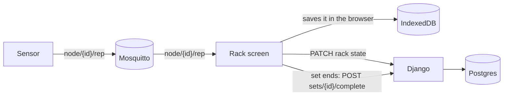
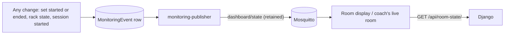

<!--
this page — every MQTT topic: what starts it, how it travels, who hears it, and
what they do next. The REST side of each step is in the message contract.

Built from the code on Nov 6, 2026: the publishers (realtime/broadcast/publisher.py,
simulate_node, the firmware's messages.cpp) and the subscribers (realtime/mqtt_ingester,
react/src/mqtt/client.js). When a topic changes, change it here.
-->

# MQTT topics

Everything that moves live. For what each REST route takes and returns, see the {doc}`message-contract`. For who may call a route, see {doc}`api`. For *why* live data goes through the broker instead of the web server, see {doc}`../../journal/core/real-time`.

**Everything is collapsed below the two flows.** Open the topic you need.

## How one rep travels



1. **The sensor** publishes each rep on `edgeathlete/node/{id}/rep` the moment it ends, at QoS 1.
2. **The rack screen** linked to that sensor hears it, but only while a set is running. It saves the rep in the browser's own storage first (`db/repBuffer.js`), dropping a repeat.
3. **It tells the server the rep count and latest speed** with `PATCH /api/racks/{n}/state/` ({ref}`rack controller <mc-rack-controller>`), so the room can show it. That makes a room update (the flow below).
4. **When the set ends,** it sends every rep at once with {ref}`POST /api/sets/{id}/complete/ <mc-set-complete>`. That's the only place `Rep` rows are written. The browser's copy is cleared only after the server confirms.

**Django never hears a rep over MQTT.** It only gets reps in that one set-complete request.

## How a room update travels



1. **Something changes:** a set starts or ends, a rack's state moves, a session starts or ends. The handler writes a `MonitoringEvent` row.
2. **The `monitoring-publisher` worker** sends each row, in order, as a `room_state_changed` message on `edgeathlete/dashboard/state`, retained, and waits for the broker to confirm before marking it sent.
3. **The room display and the coach's live room** hear it. The message carries no athlete data, only "revision 418 happened."
4. **They fetch the truth** with {ref}`GET /api/room-state/ <mc-room-state>`, skipping any revision they've already seen.

## At a glance

| Topic | Published by | Heard by | QoS |
|---|---|---|---|
| `edgeathlete/node/{id}/rep` | sensor firmware, `simulate_node` | the rack screen linked to that sensor | 1 |
| `edgeathlete/node/{id}/pulse` | sensor firmware, `simulate_node` | Django's subscriber | 0 |
| `edgeathlete/node/{id}/motion` | sensor firmware | **nothing yet** | 0 |
| `edgeathlete/dashboard/state` | `monitoring-publisher` (retained); Django | the room display, the coach's live room | 1 |
| `edgeathlete/rack/command` | Django | every rack screen | 1 |
| `edgeathlete/system/wifi` | Django, local only | rack screens, the room display | 1 |
| `edgeathlete/rack/{n}/state` | Django | **nothing yet** | 1 |
| `edgeathlete/coach/state` | **nothing yet** | nothing | — |

## How messages get to the broker

| | Local install | Remote server |
|---|---|---|
| Sensors and Django | plain MQTT, port **1883**, anyone on the base station's Wi-Fi | sensors: **`wss://<school>/sensors`**, each with its own token, publishing only under its own `edgeathlete/node/<id>/`. Django and the workers: 1883, inside the cluster only |
| Browsers | MQTT over WebSockets, port **9001** | **`wss://<school>/mqtt`**, listen only |

**Rules for every message:** JSON, every topic under `edgeathlete/`, timestamps in ISO 8601 UTC (`"2026-07-07T07:23:55Z"`), and an athlete is always `{ "id": 4, "name": "Jordan Lee" }`, never a bare id or name.

## From the sensor

:::::{dropdown} `edgeathlete/node/{id}/rep` — one completed rep
**What starts it:** a rep ending. The firmware ends a rep once the bar has slowed and stopped.

**How it travels:** QoS 1. The firmware keeps a rep that ended while it was offline and sends it on reconnect. A rep can arrive twice.

**Who hears it, and what next:** the rack screen linked to this sensor, only while a set is running. It saves the rep, drops a repeat, and updates the rack's state (step 3 of the rep flow).

```json5
{
  "node_id": "ea-169a84",   // "ea-" + the last 3 bytes of the chip's Wi-Fi address
  "rep_number": 1,          // 1 to 100, then wraps. Advisory ordering only
  "mean_velocity": 0.72,
  "peak_velocity": 0.91,
  "duration_ms": 640,
  "timestamp": "2026-07-07T07:23:55Z"
}
```
- **Not sent** until the sensor's clock is set: a rep without a time is dropped.
- **Not here:** `velocity_color`. The rack screen works it out ([Who computes what](database-tables.md#who-computes-what)).

:::::

:::::{dropdown} `edgeathlete/node/{id}/pulse` — heartbeat, every 5 seconds
**What starts it:** a timer on the sensor.

**How it travels:** QoS 0. A lost one is replaced 5 seconds later.

**Who hears it, and what next:** Django's MQTT subscriber (`realtime/mqtt_ingester`), which listens to `edgeathlete/node/+/pulse` **only** and updates that sensor's `Node` row: battery, signal, firmware, last seen.

```json5
{
  "node_id": "ea-169a84",
  "event_type": "pulse",
  "battery_level": 100,      // fixed at 100 for now: the sensor is USB-powered
  "signal_strength": -55,    // Wi-Fi RSSI, -120 to 0
  "firmware_version": "2.3.5",
  "timestamp": "2026-07-07T07:23:55Z"
}
```

:::::

:::::{dropdown} `edgeathlete/node/{id}/motion` — live bar speed, 10 a second
**What starts it:** a timer on the sensor, every 100 ms.

**How it travels:** QoS 0.

**Who hears it:** nothing yet. It's there for a live speed readout on the rack screen.

```json5
{ "node_id": "ea-169a84", "event_type": "motion", "velocity": 0.412, "timestamp": "2026-07-07T07:23:55Z" }
```

:::::

## From the server

:::::{dropdown} `edgeathlete/dashboard/state` — "the room changed"
**What starts it:** any handler that writes a `MonitoringEvent` row: a set started or ended, a rack's state changed, a controller taken or released, a session started or ended, a sensor linked.

**How it travels:** QoS 1 and **retained**, so a screen that connects late still gets the newest one. The `monitoring-publisher` worker sends rows in order and waits for the broker to confirm each.

**Who hears it, and what next:** the room display and the coach's live room (`roomMonitor.js`, `useLiveRoomState.js`). They ignore anything but `room_state_changed`, skip a revision they've seen, and call {ref}`GET /api/room-state/ <mc-room-state>`.

```json5
{ "schema_version": 1, "type": "room_state_changed",
  "reason": "set_completed",               // set_started, set_completed, session_started, rack_state_changed, …
  "revision": 418,                          // goes up each time
  "event_id": "6f1c…", "occurred_at": "2026-07-07T07:23:55Z" }
```

Django also sends a **`leaderboard_update`** on this topic after every completed set ({ref}`POST /api/sets/{id}/complete/ <mc-set-complete>`). **Nothing listens to it at the moment.**

```json5
{ "type": "leaderboard_update", "athlete": {"id":4,"name":"Jordan Lee"}, "rack_number": 3,
  "avg_velocity": 0.70, "peak_velocity": 0.91, "reps_completed": 5, "is_false_set": false,
  "is_velocity_pr": true, "is_weight_pr": false }
```

:::::

:::::{dropdown} `edgeathlete/rack/command` — "go back to setup"
**What starts it:** a coach releasing a rack. {ref}`DELETE /api/racks/{n}/ <mc-rack-remove>` sends it with that rack's number; `POST /api/racks/release-all/` sends `"all"`.

**How it travels:** QoS 1, fire-and-forget. A screen that's off finds out the next time it asks the server who it belongs to.

**Who hears it, and what next:** every rack screen, from boot, assigned or not (`RackCommandListener` in `App.jsx`). If the target matches itself, it goes to `/rack/setup`.

```json5
{ "type": "enter_setup", "target": "all" }   // "all", a rack number, or a screen's device_id
```
- `type` is an envelope: an `identify` command (flash a screen so a coach can spot it) is reserved but not built.

:::::

:::::{dropdown} `edgeathlete/system/wifi` — the Wi-Fi password is about to change (local only)
**What starts it:** a coach changing the base station's Wi-Fi password (`POST /api/system/wifi-password/`). The host agent waits a few seconds after this before it restarts the access point.

**How it travels:** QoS 1, **not retained**.

**Who hears it, and what next:** rack screens and the room display (`WifiChangeOverlay.jsx`), which show the new password so someone can rejoin them after they drop off. The coach typed it, so the coach's screen doesn't need it.

```json5
{ "type": "wifi_password_changing", "password": "the-new-password" }
```
- **It puts the password on the broker in the clear.** Anything on the gym's Wi-Fi can read it. That's an accepted trade on a closed network with trusted screens.

:::::

:::::{dropdown} `edgeathlete/rack/{n}/state` — sent, but nothing listens
**What starts it:** {ref}`POST /api/sets/ <mc-set-create>` sends `athlete_checkin` (despite the name, it's a set *starting*; the check-in route doesn't send it). {ref}`POST /api/sets/{id}/complete/ <mc-set-complete>` sends `set_complete`. Neither is sent for a set with no sensor on a rack.

**Who hears it:** nothing. `subscribeRackState()` exists in `react/src/mqtt/client.js` but no screen calls it.

```json5
{ "type": "set_complete", "set_id": 12, "athlete": {"id":4,"name":"Jordan Lee"},
  "reps_completed": 5, "avg_velocity": 0.70, "peak_velocity": 0.91, "is_false_set": false }

{ "type": "athlete_checkin", "athlete": {"id":4,"name":"Jordan Lee"}, "rack_number": 3 }
```

:::::

:::::{dropdown} `edgeathlete/coach/state` — reserved, nothing sends it
`publish_coach_state()` exists in `realtime/broadcast/publisher.py`, but nothing calls it and nothing subscribes. It was meant for a fatigue alert. Don't build against it until something sends it.

:::::
