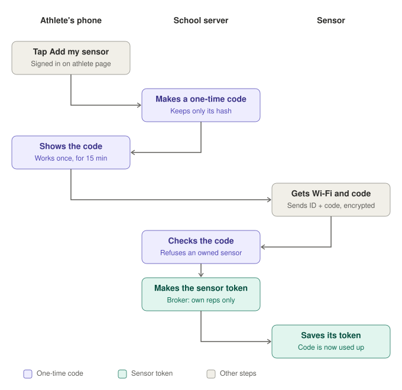
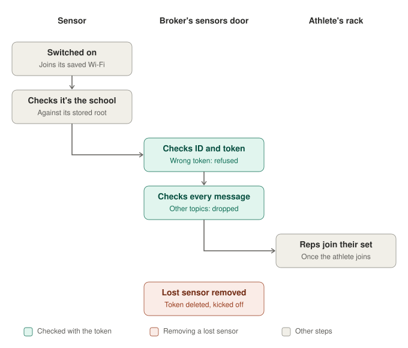

<!--
this page — what changes for a sensor that talks to a server on the internet instead
of a box in the same room, and what the sensor's setup flow demands of the circuit
board.

Remote athletes are assumed to own a sensor. That makes this the largest single piece
of new work in the remote plan, and the only one with hardware in the loop. The setup
flow itself comes last, but it decides what goes on the board — so the board
requirements are recorded here now, before anything is printed.
-->

# Sensors over the internet

**Remote athletes have their own sensor.** Typing reps in by hand is not the remote
flow; the sensor is.

## What forced it

The node firmware (`esp32/edge_athlete_node/`) was written for the gym box's own Wi-Fi,
and it is right for that network:

- **The Wi-Fi name and password and the broker's address** live in `secrets.h`, and
  the node's ID is a constant in the sketch — all fixed when the firmware is built.
- It speaks **plain MQTT on port 1883** — nothing encrypted.
- The broker accepts **anonymous** connections, and anyone may publish to any topic.
- The server's `node_register` route is open to anyone.

On a closed network each of those is reasonable. On the internet, each is a way in:
anyone could read every rep in flight, publish reps as any sensor, or register devices.

And a sensor whose settings are fixed at build time needs **a firmware build per
athlete**, because every athlete's home Wi-Fi is different.

## What we chose

### The connection

| | Gym box (unchanged) | Hosted |
|---|---|---|
| Broker address | the box's IP | a **hostname** — the installation's own address |
| Transport | plain MQTT, 1883 | **MQTT over WebSockets with TLS, on 443** (`wss://<school>/sensors`; was 8883 until 2026-10-19) |
| Who may connect | anyone on the box's Wi-Fi | **each sensor with its own ID and sensor token** |
| What a sensor may publish | any topic | **only its own** `edgeathlete/node/<its id>/…` |
| Registering a sensor | open route | **claimed with a one-time code from the athlete's page** (spec 14) |
| A sensor belongs to | a rack | **an athlete** |

**A sensor belongs to an athlete, not a rack**, once it leaves the gym. When the
athlete joins a session, their sensor is pointed at the rack slot the server gave them
({doc}`access`). The reps, sets and topics downstream do not change.

### Sensors use the web's own port, 443, not 8883

Decided 2026-10-19 (spec 14, `specs/remote/14-sensors-online.md` in the repo).

**What forced it.** The first plan gave sensors the usual port for encrypted MQTT,
8883, and rejected WebSockets for sensors because the old firmware library would have
needed extra code. Two things changed that:

- The firmware is moving to **ESP-MQTT** anyway (see "Getting every rep through"
  below), and ESP-MQTT speaks MQTT over WebSockets with TLS as one setting, including
  QoS 1. The extra-code reason was gone.
- 8883 would have needed **a second port opened on the home router**, a second kind of
  route in Traefik (raw connections rather than web traffic), and it is **blocked on
  many networks** an athlete might lift on: hotels, guest Wi-Fi, some apartments.

**What we chose.** Sensors connect to `wss://<school>/sensors` on 443, the port the
site already uses. The connection starts like an ordinary HTTPS request and then
switches to WebSockets; it is encrypted with the school's own certificate, which renews
by itself. It is still MQTT, with QoS 1 for reps.

**Sensors get their own door on the broker**, not the screens' one. The screens' door
(`/mqtt`) is listen-only: anyone may listen, nobody may send. A sensor's whole job is
sending, so the sensors' door is the opposite: nobody gets in without a sensor token,
and each sensor may send only under its own `edgeathlete/node/<its id>/`.

| Door | Address | Who | May |
|---|---|---|---|
| Programs | inside the cluster only (1883) | django and the workers | everything |
| Screens | `wss://<school>/mqtt` | any browser | listen only |
| Sensors | `wss://<school>/sensors` | each sensor, with its own token | send its own reps only |

**What we rejected.**

- **8883, MQTT over TLS without WebSockets.** Slightly less work for the sensor on
  each message, at the cost of a router port, a new kind of Traefik route, and sensors
  that can't connect from networks that block it.
- **Sharing the screens' door.** It would have to allow sending, for everyone on it.

**What it cost.** A little more memory and a few more bytes per message on the sensor
for the WebSocket layer. The router keeps only 80 and 443 open.

### Setting a sensor up, and why it's safe

Decided 2026-10-19 (spec 14). Three words are kept apart on purpose:

- the **account password**: what a person signs in with;
- the **one-time code**: what an athlete types once, to claim a sensor;
- the **sensor token**: a long random secret the server makes for one sensor, which
  the sensor keeps and sends each time it connects (in MQTT's password field).

**What forced it.** A sensor's ID is printed on its label and appears in every message
it sends, so anyone can learn it. An ID alone would let anyone send reps as that
sensor; something secret has to prove it. And the athlete should be able to set their
sensor up alone, then just switch it on.

**What we chose: the athlete claims their sensor with a one-time code.**

1. On their athlete page, the athlete presses **Add my sensor** and gets a code like
   `K7MQ-2XPR`. It works once, for 15 minutes, and the server keeps only a one-way hash
   of it, so a copy of the database can't use it.
2. The athlete gives the sensor their Wi-Fi and the code (over USB for now, the
   sensor's own setup page later).
3. The sensor sends its ID and the code to the school, encrypted. The school checks
   the code, refuses a sensor someone else already owns, records the athlete as the
   owner, and makes the sensor's token.
4. The school tells the broker: this ID, with this token, may send only under its own
   topics. It uses the broker's built-in dynamic security plugin, so this takes effect
   at once, with no restart. (Checked against Mosquitto 2.0.22 with the remote
   settings: the right token connects and can send only its own reps; a wrong token, no
   login and a removed sensor are refused.)
5. The token goes to the sensor once, and the code is used up.

From then on the sensor joins its saved Wi-Fi, checks that the server really is the
school (against the root certificate it carries), and connects with its ID and token.
The broker checks the token when it connects and every message after. When the athlete
joins a session, the server points their sensor at their rack (spec 04). A lost sensor
is removed by its athlete or a coach: its token is deleted at the broker and it is
disconnected; nothing else changes and its past sets are kept.

**Why a code and not the athlete's account password,** typed into the sensor during
setup:

- **The account password never passes through the sensor.** A sensor can be taken
  apart and read, and a fake "sensor" network could put up a page that collects
  whatever is typed. A code can only add a sensor, once, for 15 minutes.
- **The sensor's setup page can't have the padlock a website has.** The sensor serves
  it itself, on its own small Wi-Fi network, so it should never ask for a real
  password.
- **For the athlete it is the same effort**: type 8 characters instead of a username
  and password. It is the same idea as a login link.

**The coach no longer links remote sensors.** Claiming does it. The coach can see an
athlete's sensor and remove a lost one. Gym sensors are unchanged: a coach links them to
racks.

**What we rejected.**

- **The ID alone, or the chip's network (MAC) address, as proof.** Both are public.
- **The athlete's account password, or its stored hash, on the sensor.** A stored hash
  works as a password: whoever copies it out of the sensor can sign in as the athlete.
  Changing the account password would also break the sensor.
- **A certificate per sensor** (a private key on each sensor, like an SSH key). Strong,
  but checked at Traefik, where the broker can't see which sensor connected, and it
  needs a small certificate authority per school.
- **Tokens made by hand and kept in a file on the broker.** Simple, but only the
  operator could add a sensor, so athletes couldn't set themselves up.

**What it cost.** Django becomes the broker's administrator on the sensors' door, with
its own login kept in the school's secret. Sensor logins live on the broker's disk; if
that disk were lost, every sensor would claim again with a fresh code.

### Settings live on the sensor, per network — built now

**One firmware for every sensor.** Nothing about a particular athlete, network or
server is compiled in. The sensor stores a short list of **saved networks** in its
flash, and each entry carries everything needed to use that network:

| Per saved network | Example: gym | Example: home |
|---|---|---|
| Wi-Fi name and password | the gym box's network | the athlete's home Wi-Fi |
| Server | the gym box | the installation's hostname |
| Encryption | off | TLS, validated against the stored root |
| Sensor's credential | none | its own ID and sensor token |

A saved network is not just a password — **it is a password paired with the server it
leads to.** In the gym, the base station's network is simply another saved entry.

For the directed study, entries are written **over USB** by a small command-line tool.
The setup page below writes the **same stored format** later, so nothing built now is
thrown away.

### Two details that would break it in week twelve

**Trust the certificate authority's root, never the certificate itself.** The
server's certificate renews automatically every few months ({doc}`hosting`). A sensor
that pins that certificate — or the intermediate that signed it — stops connecting at
the first renewal, silently, all at once. The firmware carries the long-lived root and
validates the chain against it.

**The sensor needs the correct time before TLS will work at all**, because a
certificate is only valid between two dates. The firmware already sets its clock from
an NTP server; hosted entries must point it at a public one, not at a gym box that is
not there.

### The setup flow — last, but decided

The chosen approach is a **setup page served by the sensor itself** — a captive portal.
No app to install, and it works the same on every phone.

- The sensor opens its own Wi-Fi network, answers every DNS lookup with its own
  address, and serves one small page. **The phone's portal check pops that page open
  automatically.**
- The sensor runs its access point and joins other networks **at the same time**, so
  the page can list nearby networks, try the chosen one live, and report success or a
  wrong password on the spot.
- **The same page takes the athlete's one-time code**, so one screen sets up Wi-Fi and
  links the sensor to the athlete (see "Setting a sensor up, and why it's safe" above).

Plan around:

- **An iPhone's portal window is short-lived** and closes when the phone leaves the
  sensor's network. The page is one small file of plain JavaScript.
- **The sensor's network changes channel** when the sensor joins the home network,
  dropping the phone briefly. The page reconnects and asks for status again.
- **The ESP32-C6 is 2.4 GHz only.** A 5 GHz-only home network cannot be joined; the
  page should say so rather than fail silently.
- **The setup network has a password**, printed on the sensor's label. Never open.
- **There is always a way back into setup** — a long press, or reopening the portal on
  its own when every saved network keeps failing.

School Wi-Fi, with its sign-in pages and certificates, is deliberately not a case:
athletes on campus lift in the school's weight room, on the base station's network.

### What this demands of the circuit board

These are **hardware** requirements. The firmware can change after a board is printed;
these cannot.

| Requirement | Why |
|---|---|
| **A setup button** on a free GPIO | long press to re-enter setup |
| **A status indicator** — at least one LED, ideally multi-colour | shows setup mode / connecting / connected / failed without a screen |
| **Space for a label** | the sensor's setup-network password, and its ID |
| **Antenna placement and clearance** for 2.4 GHz | the only band the C6 has; a poorly placed antenna is a range problem no firmware fixes |

### The motion sensor: BNO085, replacing the MPU-6050

Decided 2026-10-08. The first remote sensor is built on a **Seeed XIAO ESP32-C6 with a
BNO085** (the BNO086 is the same family and would also do). Both parts are ordered.

**What forced it.** The first sensor used an MPU-6050, and the firmware read only its
accelerometer (`esp32/edge_athlete_node/edge_athlete_node.ino`). It measured gravity
once, while the sensor sat still, and subtracted that fixed amount from one fixed axis
for the rest of the session. The moment a bar tilts or rolls, gravity leaks into the
"movement" reading and the bar speed is wrong. The part is also old and noisy, and many
of the boards sold are clones.

**What we chose.** The BNO085 combines its own accelerometer and gyroscope on the chip
and reports:

- **linear acceleration**, with gravity already removed, and
- **its orientation**, so "up" can be worked out however the sensor is mounted.

It is used in the mode that **ignores the compass** (the "game rotation vector"): a
steel bar and a steel rack make a compass useless. It reports at 100 times a second or
faster, which matches the firmware's loop, and runs on 3.3 V over I2C like the part it
replaces.

**What we rejected.** An **ICM-42688-P** or **LSM6DSV16X**: newer, quieter and far
cheaper as bare chips, and the better choice for a printed board later. They hand over
raw readings (the LSM6DSV16X can combine them itself), so they cost firmware work the
first sensor does not need to spend. Keeping the **MPU-6050** and adding the gyroscope
in firmware: the same work, on the noisiest part of the three.

**What it cost.**

- Several times the price of an MPU-6050 board.
- The BNO08x family has a reputation for I2C trouble on some ESP32 boards, and it is
  **not yet tested on the C6**. The breakout also speaks SPI and UART if it misbehaves.
- **A better sensor fixes tilt, not drift.** Speed still comes from adding acceleration
  up over time, so it must be reset to zero whenever the bar is still. The firmware
  already detects stillness between reps; that part carries over.
- The firmware's sensor code is rewritten for the new part. The messages it sends
  (`pulse`, `motion` and `rep` under `edgeathlete/node/{node_id}/`) do not change, so
  nothing on the server does.

### Getting every rep through: the first hop is the weak one

Found 2026-10-15, while planning the remote broker. To be done in the firmware rewrite.

**What forced it.** A rep makes four hops, and only the first is unprotected:

| Hop | How the rep is protected today |
|---|---|
| Sensor → broker | **Not at all.** The firmware sends at MQTT QoS 0 ("once, and hope") and keeps no copy. If the connection is down when a rep ends, the rep is dropped (`MQTT offline; dropped rep event`) |
| Broker → rack screen | QoS 1 with a stable client ID and a kept session: the broker holds reps for a screen that is briefly offline, and keeps them on disk across a broker restart |
| On the rack screen | each rep is written to the browser's own database (`react/src/db/repBuffer.js`) before anything else; it survives reloads and Wi-Fi drops |
| Rack screen → server | the whole set is sent once at the end, and the screen's copy is cleared only after the server confirms |

The firmware is stuck at QoS 0 by its library: **PubSubClient can only send at QoS 0**,
and its own README now says it is no longer maintained. (The Bluetooth sensor agent in
`scripts/hardware/` already sends reps at QoS 1; only the ESP32 firmware does not.)

**What we chose.** Three changes, all in the firmware rewrite:

1. **Switch to ESP-MQTT**, Espressif's own MQTT client, built into the ESP32's SDK and
   maintained by the chip maker, and **send reps at QoS 1**. It keeps every unconfirmed
   message in an *outbox* and resends it until the broker confirms, including messages
   published while disconnected. The outbox is the sensor-side buffer; nothing extra to
   write. *Check first:* how cleanly it can be used from the Arduino setup.
   `espMqttClient` (an Arduino MQTT library for the ESP32) is the fallback.
2. **Keep an unconfirmed rep long enough to outlast a Wi-Fi drop.** ESP-MQTT deletes
   outbox messages after a set time; choose it to cover a realistic drop, or also keep
   the last few reps in memory.
3. **Make the rack screen ignore a repeated rep.** QoS 1 means *at least* once, so a rep
   can occasionally arrive twice, and today the screen counts every rep it receives.
   Skip one whose sensor rep number and time are already stored.

Pulses and motion stay at QoS 0: a lost one is replaced by the next a moment later.

**What it cost.** A little more memory on the sensor for the outbox, and a new library to
learn. The messages themselves do not change, so nothing on the server does.

### A sensor belongs to an athlete; a simulated one is only labelled

**Built (October 2026, spec 04).** A sensor record now has an owner. When an athlete
joins a session online, their own sensor is pointed at their own rack, and never at
anyone else's. A gym sensor has no owner and belongs to its rack, as before.

**Simulated sensors are labelled, not hidden** (decided October 17). The database had a
"simulated" flag from an earlier design: a simulated sensor couldn't be attached to a
rack, and its sets were left out of the live room, reports and max updates. Nothing ever
set it, so it did nothing, until demo data needed it. Now it is a label only: a simulated
sensor drives a rack and counts like a real one, and the label lets the demo seeder find
and remove its own rows. Nothing on a gym box is marked simulated, so nothing changes
there.

**Demo data uses it** (spec 04, Phase 5, next): the seeder gives each of its invented
athletes their own simulated sensor, and one command wakes them for two hours, so a demo
school can be shown with live reps and no hardware.

## What we rejected, and why

**Setting up Wi-Fi over Bluetooth from a web page.** Web Bluetooth does not work on
iPhones, in any browser. A setup flow that excludes iPhones is not a setup flow.

**A native phone app for setup.** It works everywhere, at the cost of building,
publishing and maintaining an app to do one job the captive portal does from a web page.

**Building firmware per sensor.** It was the first plan for the directed study. It
means a rebuild for every athlete and every change of Wi-Fi — and settings stored on
the device cost about the same to build now as compiled-in ones.

**MQTT over WebSockets from the sensor** (rejected 2026-10-08, **reversed 2026-10-19**,
spec 14). It was rejected as more code and memory on the device to save one port. Once
the firmware moved to ESP-MQTT, WebSockets became one setting, and 443 needs no router
change and gets through networks that block other ports. Sensors still get their own
door, not the browsers' listen-only one.

**One shared credential for all sensors.** Simpler to build, and one extracted sensor
would then speak for every sensor. Per-sensor credentials mean a lost sensor is revoked
alone.

**Pinning the server's certificate.** Stronger on paper; in practice an outage on
every renewal.

## What it cost

- **A sensor token lives in each sensor's flash.** Anyone holding the sensor can extract
  it — which is exactly why each sensor has its own, and why it unlocks nothing but that
  sensor.
- **TLS costs the sensor memory and a slower connect.** Fine on the ESP32-C6, but worth
  watching as the firmware grows.
- **Until the setup page exists, settings are written over USB.** Fine for a handful of
  sensors; the page is what makes it something an athlete can do alone.
- **The board has to be designed for a flow that is not built yet.** Hence the table
  above — it is the part of this plan that cannot be revised later.
